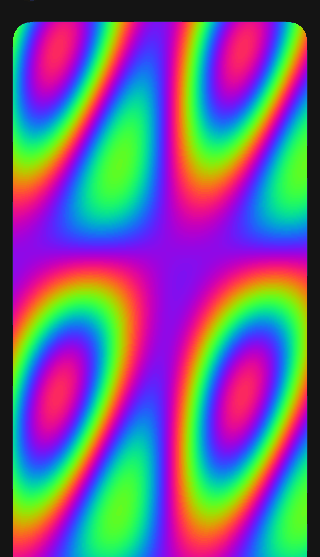
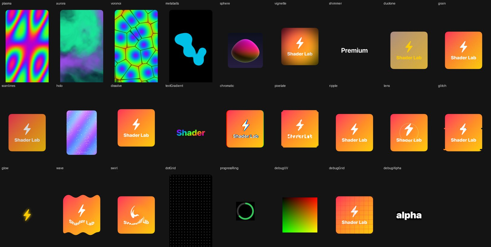

# ios-shader-guide

A Claude Code skill for writing SwiftUI and Metal shaders on iOS. Ask for a ripple, a glitch or a holographic card and Claude writes the `.metal` file and the SwiftUI view together, with the right modifier, argument types and `maxSampleOffset`. It can also port Shadertoy/GLSL code and help when an effect silently doesn't show up.

[](#requirements)
[](skills/ios-shader-guide/examples/ShaderLab)
[](LICENSE)

<p align="center"></p>

## Install

```bash
npx skills add burakaydins/ios-shader-guide --skill ios-shader-guide
```

Or copy `skills/ios-shader-guide` into `~/.claude/skills/` (for you) or `.claude/skills/` inside a project. Copy the whole folder, since `SKILL.md` points into `references/` and `examples/`.

It also works in Claude.ai and in other agents that read the `SKILL.md` format. The docs are in English and Claude answers in whatever language you write in.

## Things to ask

```
Add a light sweep across this card in SwiftUI.
Convert this Shadertoy shader to SwiftUI: <paste mainImage>
My colorEffect compiles but nothing shows up. Why?
Make a ripple that starts where the user taps.
This layerEffect drops frames in a List on iPhone 12. How do I profile it?
I want a wobbling sphere with RealityKit CustomMaterial.
```

You don't have to say "shader". Asking for a glow, a wave or a pixelate effect is enough for the skill to load.

## The demo app



`examples/ShaderLab` has every recipe wired into a small app. Open `ShaderLab.xcodeproj`, pick your team and a bundle ID under Signing, and run it. Two launch arguments help with testing: `-demo plasma` opens one demo directly and `-showFPS` puts a frame counter on screen.

## What's in the skill

There are 21 recipes, covering `colorEffect`, `distortionEffect`, `layerEffect` and shaders used as a `ShapeStyle` on text. The full list: plasma, aurora, vignette, shimmer, duotone, film grain, scanlines, holographic card, noise dissolve, gradient text, metaballs, Voronoi cells, a raymarched sphere, chromatic aberration, pixelate, tap ripple, magnifier lens, glitch, glow, wave and swirl. `advanced-techniques.md` adds SDF shapes, noise, a dot grid and a progress ring.

On the Swift side, `swift-patterns.md` shows how to feed time, touch, scroll position and device tilt into a shader. It also covers view transitions driven by a shader, chaining several effects, and Reduce Motion.

For Shadertoy ports there's a GLSL to MSL table (`mod` vs `fmod`, `atan`, `inout`, flipping the y axis). A wrapper pattern lets you keep a big shader body almost as it is. Before converting anything, the skill warns about Shadertoy's default CC BY-NC-SA license.

Debugging starts with a checklist for "the effect doesn't appear": wrong function name, missing `[[ stitchable ]]`, argument order or type, a UIKit-backed view. There are also a dictionary of compile errors, small shaders that show a value as a color, and steps for the Xcode Metal debugger.

When SwiftUI isn't the right tool, the skill says so and points to RealityKit `CustomMaterial`, ShaderGraph, `MTKView` or Core Image.

```
skills/ios-shader-guide/
├── SKILL.md              workflow and API facts Claude reads first
├── TESTING.md            how to test the demos, expected look of each one
├── references/           concepts, MSL primer, recipes, Swift patterns,
│                         Shadertoy porting, advanced techniques, debugging,
│                         RealityKit/ShaderGraph, links
├── examples/ShaderLab/   demo app (Xcode project, .metal files, helpers)
└── tools/                doc generator, argument checker, syntax checker
```

## Requirements

SwiftUI shader modifiers need iOS 17, macOS 14, tvOS 17 or visionOS 1. watchOS isn't supported. You need Xcode to compile shaders. From Xcode 26 the Metal compiler is a separate download; if the build complains about a missing Metal Toolchain, run:

```bash
xcodebuild -downloadComponent MetalToolchain
```

## Testing

Last tested on 2026-11-21 with Xcode 26.3, the iOS 26.2 Simulator and an iPhone 13 on iOS 26.7.3.

| | Result |
|---|---|
| `.metal` files | Compile and link into one library |
| Demo app | Builds for iOS 17+ in Debug and Release |
| Swift arguments vs. shader parameters | All 26 calls match (`tools/check_arguments.py`) |
| Looks | All 26 demos match `TESTING.md` |
| Speed | 60 fps on iPhone 13 for every demo over 10 s |

The fps number counts main-thread frames, so it won't catch a shader that is slow on the GPU. Use Instruments for that. Older devices haven't been measured. The Xcode Metal debugger steps come from Apple's docs and haven't been tried on a SwiftUI shader yet.

If something breaks on your device, open an issue with the Xcode and iOS versions, the device, and the error text.

## Contributing

The code in `recipes.md`, `shadertoy-to-msl.md`, `advanced-techniques.md` and `performance-debugging.md` is copied from `examples/ShaderLab/*.metal`. Edit the `.metal` file, then run:

```bash
python3 skills/ios-shader-guide/tools/build_recipes.py
python3 skills/ios-shader-guide/tools/check_arguments.py
```

and build the demo app. Without Xcode, `tools/syntax_check.py` does a rough syntax pass.

## Credits

Apple's documentation for SwiftUI `Shader`, the shader modifiers, Xcode's shader debugging articles, RealityKit and ShaderGraph is paraphrased here; Apple holds the copyright. The cosine palette, SDF and smooth-min ideas come from Inigo Quilez's articles, and the sine-free hashes follow Dave Hoskins. All shader code in this repo was written for it, including the Shadertoy-style examples.

## License

MIT. See [LICENSE](LICENSE).
